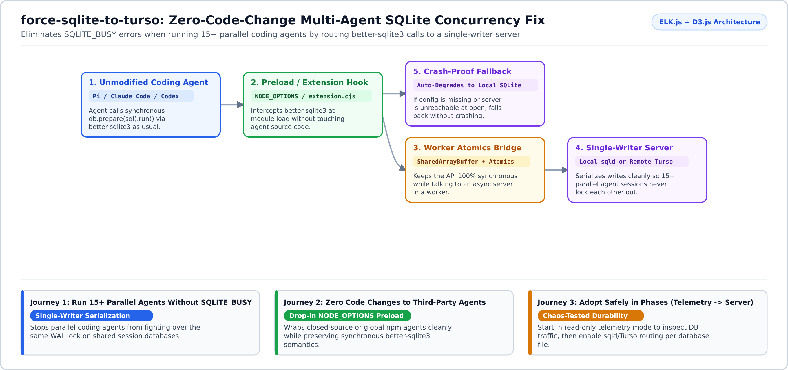
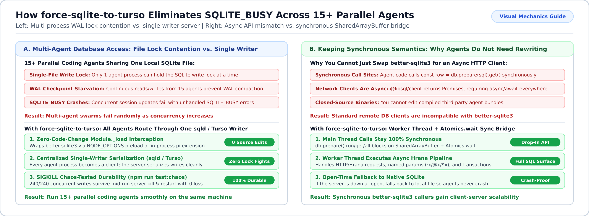

# `force-sqlite-to-turso`

**Run 15+ parallel AI coding agents without `SQLITE_BUSY` crashes—without changing a single line of agent source code.**

`force-sqlite-to-turso` is a drop-in Node.js preload (`NODE_OPTIONS="--require ..."`) and [`pi`](https://github.com/earendil-works/pi-coding-agent) extension that intercepts synchronous `better-sqlite3` calls at module load and routes them to a single-writer libSQL / Turso server (`sqld`).



---

## Why Use `force-sqlite-to-turso`? (What Problem Does It Solve?)

When you run many coding-agent sessions in parallel on the same machine (15+ concurrent processes are common in multi-agent swarms), they all read and write the same local SQLite database files:

1. **Multiple processes fighting over one SQLite file cause `SQLITE_BUSY` errors**: File-backed SQLite allows only one writer at a time, and heavy concurrent writes starve WAL checkpoints.
2. **You cannot rewrite closed-source or global npm agent binaries**: Agents like Claude Code, Pi, or Codex expect `better-sqlite3`'s **synchronous** JavaScript API (`db.prepare(sql).run()`). Replacing it with an async client would require rewriting the entire agent.
3. **`force-sqlite-to-turso` bridges synchronous calls to a single-writer server**: Using a background worker thread and `SharedArrayBuffer` + `Atomics.wait`, it keeps the agent's `better-sqlite3` calls 100% synchronous while sending writes to a single-writer `sqld` or Turso server. And if the server is offline at startup, it falls back cleanly to local SQLite so your agent never crashes.

---

## Start in 2 Minutes

```bash
# 1. Clone and create your local config
git clone https://github.com/r-irbe/force-sqlite-to-turso.git
cd force-sqlite-to-turso
mkdir -p ~/.config/force-sqlite-to-turso
cp config.json.example ~/.config/force-sqlite-to-turso/config.json

# 2. Run the verification suite (12 unit/preload checks + bridge & chaos tests)
npm test

# 3. Activate for any Node-based coding agent via NODE_OPTIONS
export NODE_OPTIONS="${NODE_OPTIONS:+$NODE_OPTIONS }--require $PWD/register.cjs"
```

---

## Adapt to Your Use Case (Customer Journeys)



You can adopt `force-sqlite-to-turso` in safe, incremental phases controlled entirely by `~/.config/force-sqlite-to-turso/config.json`:

<details open>
<summary><b>Phase 1: Observe Which Databases Your Agents Touch (`"mode": "telemetry"`)</b></summary>

- **Who this is for**: Developers who want to see which SQLite files are causing lock contention across their agents before changing any storage behavior.
- **How it works**: Wraps `better-sqlite3` in read-only observation mode, logging operation counts and latencies per database file to JSONL (raw SQL text is never logged unless you explicitly set `"logSqlText": true`).
</details>

<details>
<summary><b>Phase 2: Eliminate `SQLITE_BUSY` Locally with a Single-Writer Server (`"mode": "sqld"`)</b></summary>

- **Who this is for**: Power users running 4 to 20+ concurrent agent sessions on one workstation.
- **How it works**: Manages a local single-writer Hrana/libSQL server and routes opted-in database files (`"route": "sqld"`) through the synchronous worker bridge:

```json
{
  "mode": "sqld",
  "server": {
    "command": "node",
    "args": ["/path/to/loomdb-plane.cjs", "start", "--config", "/path/to/plane.json"],
    "healthUrl": "http://127.0.0.1:8081/health",
    "url": "http://127.0.0.1:8081"
  },
  "stores": [
    { "match": "sessions.db", "route": "sqld", "redactPath": true }
  ]
}
```

Manage the server lifecycle directly from the CLI:
```bash
node bin/force-sqlite.cjs status   # Inspect active mode, routed stores, and server health
node bin/force-sqlite.cjs doctor   # Verify config and server reachability
node bin/force-sqlite.cjs start    # Launch health-gated background server
```
</details>

<details>
<summary><b>Phase 3: Route to Remote Turso / libSQL (`"mode": "libsql"`) or Load as a Pi Extension</b></summary>

- **Remote HTTPS Endpoint**: Point `server.url` and `server.authToken` at a remote Turso/Hrana `https://` endpoint.
- **Native Pi Extension**: Because `package.json` declares `"pi": { "extensions": ["./extension.cjs"] }`, `pi` loads it automatically on `session_start`, patching `Module._load` in-process and exposing `sqlite_route_status` and `sqlite_route_doctor` tools.
</details>

---

## Verified Compatibility & Durability

<details>
<summary><b>View supported better-sqlite3 API surface, chaos test results, and agent compatibility</b></summary>

### Chaos-Tested Durability (`npm run test:chaos`)
- 6 concurrent writer processes x 40 inserts (`240/240` acknowledged, `0` failed) through a live Hrana server, followed by mid-run `SIGKILL` and automatic restart: **100% of acknowledged commits survive with zero corruption**.

### Supported `better-sqlite3` Surface (`npm run test:bridge`)
- **Supported**: `new Database(path)`, `prepare().run/get/all`, positional and named parameters (`:n`, `@n`, `$n`), multi-statement `exec()`, `pragma()`, `transaction(fn)` with automatic rollback on throw, `.bind()`, `.pluck()`, `.raw()`, and `.iterate()`.
- **Fallback Safety**: If the server is unreachable when `new Database()` is called, the shim logs `route_fallback_to_sqlite` and opens the local file with native `better-sqlite3` so the agent session never crashes.
</details>

## License

Apache-2.0
